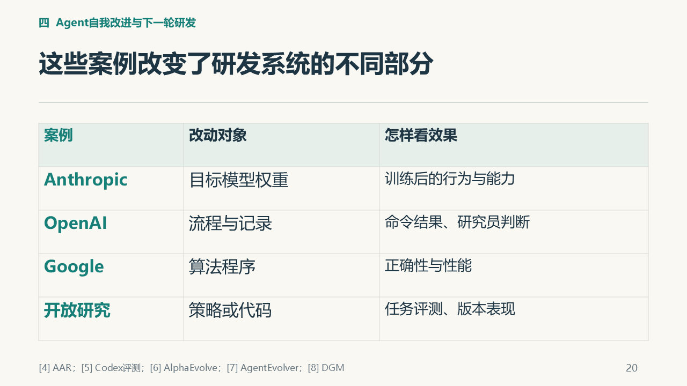
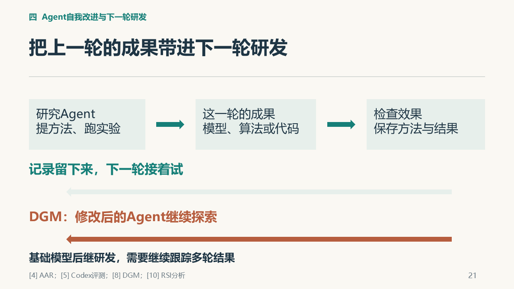

# A｜陈云海：个人报告素材

**方向：Agent for Agent的整体研究与分析。** 全场01—24页；A开场是出发点，报告覆盖跨案例分析。

这份素材页已合并论述、关键图、出处和参考提示词；第二份材料是[配套投影PDF](../v5/outputs/智能体产业研发_V5_11_主讲.pdf)。按这两份准备即可。组长已询问老师，具体要求待助教安排：目前用于理解和准备，正式要求出来后再定稿。

[直接复制AI提示词](#交给ai的参考提示词) · [查看参考来源](#参考来源)

## 建议的文章组织

研究问题与背景 → 负责案例和机制 → 结果与分析 → 与全场主题的联系 → 真实贡献与体会 → 参考文献。结构和篇幅以助教正式要求为准，写作风格由本人选择。

## 研究范围

本报告中的“Agent for Agent”指Agent参与支撑Agent能力的模型、工具、流程及Agent自身的研发。它是全场研究问题，不把每个案例都说成直接训练同一个Agent，也不把所有自动研究都等同于RSI。报告重心是综合分析，技术例子用于支撑判断。

## 动机与概念

Agent的应用性能既取决于模型能力，也取决于工具、评测和行动流程。过去主要依赖人编写实现和运行实验的研发工作，今天也开始由Agent参与。因此，我们选择AI研发作为应用行业，而不把它泛化成所有软件开发。本报告沿同一个问题比较不同改动对象，不声称所有案例都训练了同一个baseline Agent。[4]—[8][10]

RSI是Recursive Self-Improvement，递归自我改进，强调改进后的系统继续推动后续改进。Good、Gödel Machine与神经架构搜索提供历史和方法背景；本文以今天可追踪的研发工作为主要分析对象。[1]—[3][10]

Karpathy在2026年3月的autoresearch项目提供了直观入口：Agent修改训练代码，让小模型训练，再比较验证指标，保留或丢弃修改后继续尝试。原版单GPU，训练预算为5分钟，不含启动与编译；整轮还需代码修改、推理和检查等开销。[12] 自动研究方向并非始于此，2024年的The AI Scientist已探索自动科学发现。[14] autoresearch自动化研究过程，RSI进一步追问研究者的后续改进能力是否随之提高；二者相关，不能仅凭一次循环就视为同一个已实现结果。

这种关联的意义在于研发正反馈。更强的AI帮助找到和验证方法，研发成果又可能提高下一轮研究能力，收益便有机会逐轮积累。若增益持续、周期与资源允许，可能出现复利式甚至指数式加速；一张反馈图本身并不能证明这种速度已经实现。算力、能源、评测和研究判断仍可能成为瓶颈。[10] 相关经济学研究讨论反馈强度和加速条件，是建模与估计，不能当作已测得的增长定律。[15]

## 跨案例比较

| 案例 | 主要改变对象 | 可检查依据 | 继续关注的问题 |
|---|---|---|---|
| Anthropic AAR | 后训练方法与目标模型参数 | 实现、训练产物与行为评测 | 换一种失败任务，方法是否仍有效 |
| OpenAI作者工作流 | 评测流程与外部记录 | 计划、执行输出与决定 | 新记录能否改善后续评测工作 |
| AlphaEvolve | 算法和程序 | 正确性、运行性能与训练应用 | 其他训练环节能否也获得收益 |
| AgentEvolver | Agent策略参数 | 任务生成、经验引导、归因与策略优化实验 | 后续任务表现与资源消耗怎样 |
| DGM | 固定底模之上的Agent代码和工具 | 版本档案、后代参与修改与编程基准结果 | 改进能否迁移，继续迭代后的表现怎样 |

比较时沿三个问题组织：改变了什么，结果怎样检验，成果如何作用于下一轮。Anthropic的引导教师与蒸馏学生可作为参数训练的短例；Runme说明记录复用；AlphaEvolve说明程序优化；AgentEvolver和DGM分别说明策略参数训练与固定底模上的代码修改。各例承担不同论证作用，不作公司能力排名。[4]—[8]

## 研究成果怎样进入下一轮

下一轮工作的起点，可能是一份新的实验记录，也可能是一个修改后的Agent版本。AAR和Runme让研究者读取之前的方法、结果与决定，接着开展尝试；这不自动意味着研究者参数被更新。DGM进一步修改Agent自身代码，让档案中的版本继续参与后续修改，已有代码层局部递归自改的实例。这两条返回路径分别带回记录与修改后的Agent，改变的位置不同。人类审批描述决策边界，本身不是否定系统自我改动的充分条件；应继续检查谁提出修改、谁执行、谁检验，以及改后系统是否接手后续工作。[4][5][8]

若把这种迭代推进到基础模型研发，一个直接的比较办法，是让原版与改进版在同一组新任务上各做一轮研究，并给出相同的时间与算力预算。比较对象包括找到的方法及其实际效果，也包括失败尝试、人工帮助和资源消耗。然后换任务、继续迭代几轮，观察收益是否保持，是否出现能力退化或绕过测试的情况。这样的跟踪有助于检验，新版本是否更擅长研发下一代系统。**这对应主讲第22页，是本组提出、尚未执行的比较建议，不是论文已经完成的实验，也不是一套通用RSI认证。** [10]为问题背景，具体比较设计为本组分析。

解释当前案例时，实验范围仍然重要。AAR的单次消融、AlphaEvolve的局部算子优化和DGM的代码任务，各自回答了具体问题。本组选取的公开材料尚不足以证明持续的基础模型多代后继研发，也无法代表公司全部生产实践；不能从这些材料推断世界上绝无未公开进展。本文据此关注可继续测量的后续结果，不预测RSI实现日期。

## 可形成的综合结论

智能体已经进入AI研发的具体工作：它能够提出并实施训练方法，协助执行评测，优化训练算法，也能训练策略或修改自身代码。DGM让修改后的Agent继续参与修改，表明局部代码递归自改已有实例。这些案例让机器参与机器设计的设想有了可运行的进展。理解它们，需要先找到改动发生的位置，再看结果如何进入后续研发。

接下来最值得观察的，是改进后的研究系统能否持续产出更强的基础模型。单项成果值得保留，后续研究则应跟踪同样预算下的方法质量、换任务后的表现，以及连续几轮的收益和代价。沿着这一个个具体结果讨论，才能说明AI辅助研发走到了哪里，以及下一步可能怎样继续。

## 已有关键图

以下为最终PPT中的图示线索，配套PDF保留完整页面。图来自已有汇报材料，教学示意不是本组实验结果；书面稿按需要选图并保留图注与来源。

### 全场第20页：不同案例改变了研发系统的哪些部分



### 全场第21页：研究记录与修改后的Agent分别进入下一轮



## 交给AI的参考提示词

复制本段，附本页、配套投影PDF和助教正式要求；补充自己的表达与排版偏好。

```text
请把本页和配套投影PDF作为已有内容输入，结合我提供的教师/助教正式要求，整理成我的个人课程报告。本页已包含论述素材、图示、出处、写作方向和参考提示词，报告准备以这两份材料为入口。

正式要求未提供时，只整理提纲和内容对应，不假定模板、页数、格式或截止日期。正式要求提供后，按要求和我喜欢的表达、排版风格成文；Markdown、Word或PDF按实际需要选择。把口播改为连贯书面论述，让文章能够独立阅读，图表配说明和出处。图示来自最终PPT，可据其重绘或选取相关机制，不将整页投影简单堆成报告。

复用本页已有研究，不新增实验或案例，不修改全组PPT。数字保留对象、分母和条件，公开研究结果、教学示意、本组分析、未执行建议分别表述。本组没有复现文中公开研究，不能写成自己的实验成绩。先核对我实际做过什么，再写个人贡献与体会；未知处留待本人确认，不编造学习经历或排练反馈。完成后留给我通读、修改和确认。

我的报告定位是研究整个“Agent for Agent”话题：Agent如何参与Agent及其依赖的模型、工具和流程的研发，以及改进怎样作用于下一轮研发。不要只把A七页开场改成报告，也不要把全场材料逐段拼接。

以全场研究问题为主线，说明研究范围、RSI与autoresearch的关系，再综合B的模型训练、C的评测流程与程序优化、D的策略训练与代码自改。用适量技术实例支撑比较：改动对象是什么，谁提出和执行修改，怎样验证，成果如何被后续研究利用。重点形成跨案例分析、结论和局限，不以罗列技术细节取代论证。

承认代码层局部递归自改已有实例，同时审慎讨论持续基础模型后继研发的证据；不把外部记录复用等同参数训练，不把所有研发辅助都称为RSI。结合我实际承担的选题、问题框架、审核、统稿和衔接工作，待我确认后写个人贡献与体会。复用现有研究，不另开一轮大范围调研。
```

## 本人最后确认

- 实际完成的工作与修改：由本人填写。
- 自己理解最深或曾经困惑的内容：由本人填写。
- 本人的判断、局限与体会：由本人填写。
- 核对图、引用和数字，按助教要求修改后再提交。

以上内容依据真实经历补充，素材准备完成不代表本人已试讲或开展实验。

## 参考来源

沿用全场固定编号；均为公开研究，未由本组复现。下列原文链接用于具体查证，不要求另读仓库旧讲稿。

**[1]** GOOD I J. Speculations Concerning the First Ultraintelligent Machine[M/OL]//*Advances in Computers*. Vol.6. Academic Press, 1965:31–88. DOI:10.1016/S0065-2458(08)60418-0. [原文PDF](https://scienceplusplus.org/metascience/assets/Good1965.pdf).

**[2]** SCHMIDHUBER J. Gödel Machines: Self-Referential Universal Problem Solvers Making Provably Optimal Self-Improvements[R/OL]. Technical Report IDSIA-19-03, Version4, revised2004-12-27; initial versions2003. [作者原文](https://people.idsia.ch/~juergen/gmweb4/gmweb4.html).

**[3]** ZOPH B, LE Q V. Neural Architecture Search with Reinforcement Learning[EB/OL]. arXiv:1611.01578, initial submission2016-11-05, v2 revised2017-02-15. DOI:10.48550/arXiv.1611.01578. [论文](https://arxiv.org/abs/1611.01578).

**[4]** CHEN YUEH-HAN, WEN JIAXIN, KIRCHNER JAN HENDRIK. Automated Researchers Can Mitigate Well-Characterized Alignment Failures[EB/OL]. Anthropic Alignment Science Blog,2026. Work done during the Anthropic Fellows Program. [研究正文与附录](https://alignment.anthropic.com/2026/automated-alignment-researchers/).

**[5]** LEWI J. Automating repetitive work at OpenAI with Codex[EB/OL]. OpenAI Developers Blog,2026-08-25. [作者工作流](https://developers.openai.com/blog/automating-repetitive-work-at-openai-with-codex).

**[6]** ALPHAEVOLVE TEAM. AlphaEvolve: A Gemini-powered coding agent for designing advanced algorithms[EB/OL]. Google DeepMind,2025-05-14. [官方介绍](https://deepmind.google/blog/alphaevolve-a-gemini-powered-coding-agent-for-designing-advanced-algorithms/).

**[7]** ZHAI Y, TAO S, CHEN C, et al. AgentEvolver: Towards Efficient Self-Evolving Agent System[EB/OL]. arXiv:2511.10395v1,2025-11-13. Tongyi Lab, Alibaba Group. [本文固定采用v1](https://arxiv.org/html/2511.10395v1).

**[8]** ZHANG J, HU S, LU C, LANGE R, CLUNE J. Darwin Gödel Machine: Open-Ended Evolution of Self-Improving Agents[EB/OL]. arXiv:2505.22954, initial submission2025-05-29. DOI:10.48550/arXiv.2505.22954. [论文及版本记录](https://arxiv.org/abs/2505.22954)、[本文机制与评测所用v1](https://arxiv.org/html/2505.22954v1)。同一团队的[官方说明与结果](https://sakana.ai/dgm/)，2025-05-30。本文涉及20.0%→50.0%等数字，定位于该2025年说明及原论文v1；不把后续版本更新日期当作最初研究日期。

**[9]** OPENAI. Research acceleration: The view inside OpenAI[EB/OL].2026-09-06. [组织统计及方法说明](https://openai.com/index/research-acceleration-view-inside-openai/).

**[10]** ANTHROPIC INSTITUTE. When AI builds itself[EB/OL].2026; 页面包含2026-09-18更新。 [RSI分析](https://www.anthropic.com/institute/recursive-self-improvement). 未确认首次发布日期，故不补写月日。

**[11]** MODELSCOPE / AGENTEVOLVER CONTRIBUTORS. AgentEvolver[CP/OL].2025–. [官方代码库](https://github.com/modelscope/AgentEvolver)，README与Apache-2.0 License。仓库会持续更新，本文只用它说明框架代码与许可证，不据此宣称训练数据和全部模型权重均开放。

**[12]** KARPATHY A. autoresearch[CP/OL].2026，README署名March 2026. [作者原仓库](https://github.com/karpathy/autoresearch)。本文采用README的项目说明、How it works及Design choices；5分钟是训练墙钟预算，不含启动和编译，不是整轮总耗时。

**[13]** SRIKANTH D, ZHAO B, XU D, WU Y, JIANG Z. Recursive self-improvement of AI research agents[EB/OL]. arXiv:2609.26457v1,2026-09-22. [AIDE²原论文](https://arxiv.org/html/2609.26457v1)。A只简短引用代码层连续改进的作者报告；底模固定和外层检验边界见§2.2、§3.6。

**[14]** LU Chris, LU Cong, LANGE R T, et al. The AI Scientist: Towards Fully Automated Open-Ended Scientific Discovery[EB/OL]. arXiv:2408.06292, initial submission2024-08-12. [摘要与提交记录](https://arxiv.org/abs/2408.06292)。用于说明自动研究早于Karpathy项目，不据作者的首创表述裁定完整思想史。

**[15]** CUNNINGHAM T, ALTHOFF L, HALPERIN B, et al. The Economics of Recursive Self-Improvement[EB/OL]. arXiv:2609.15802v1,2026-09-14. [摘要与论文入口](https://arxiv.org/abs/2609.15802)。反馈强度和加速条件的建模研究，不是已测得的智能增长定律。
