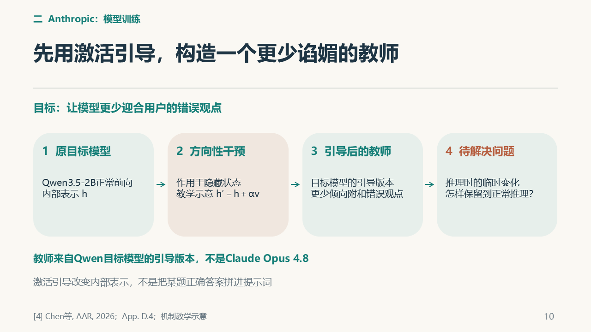
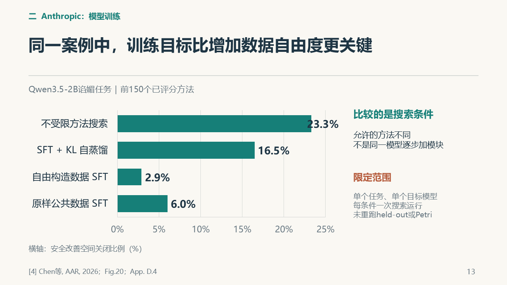

# B｜张程翔：个人报告素材

**方向：Agent提出与验证模型训练方法。** 全场08—13页；PDF第1页对应全场08页。

这份素材页已合并论述、关键图、出处和参考提示词；第二份材料是[配套投影PDF](../v5/outputs/B部分投影_V5_09.pdf)。按这两份准备即可。组长已询问老师，具体要求待助教安排：目前用于理解和准备，正式要求出来后再定稿。

[直接复制AI提示词](#交给ai的参考提示词) · [查看参考来源](#参考来源)

## 建议的文章组织

研究问题与背景 → 负责案例和机制 → 结果与分析 → 与全场主题的联系 → 真实贡献与体会 → 参考文献。结构和篇幅以助教正式要求为准，写作风格由本人选择。

## 案例、机制与结果

### 3.1 三个角色及一轮研究

Anthropic Fellows项目的一项研究，让研究者Agent寻找缓解已知对齐失败的方法。本文主讲其中的谄媚任务：目标模型不应因用户坚持错误意见而随声附和。研究Agent由Claude Opus4.8承担，负责提出和实现方法；Qwen3.5-2B接受后训练，分开的评测器检查行为改善与能力副作用。基本规则禁止将评测数据用于训练，也禁止从研究Agent本身或更强模型蒸馏。后文的教师来自目标模型经过引导的版本，与这种被禁止的蒸馏来源不同。这三个职责不能合并成“一个模型自己证明自己变好了”。[4]

研究流程从阅读资料和提出假设开始。Agent在看到本轮结果前冻结小论文，提交可执行实现；代码经过监控后，工具训练目标模型，评测结果再进入共享记录。冻结研究说明使人能够对照原先假设检查结果，减少只在成功之后编写解释的空间。典型方法受到约一张H200、半小时的执行预算约束，因而交付物必须能运行，不能停在想法层面。[4]§2—3。

多个研究Agent并行探索，共享方法、评分和讨论记录。新的会话可以读取这些资料，继续提出候选。因此，研究接续首先依赖外部记忆，而不是聊天越长就自然学会了。研究Agent读取结果，亦不意味着其自身参数在每轮发生更新。真正接受参数改变的是目标模型；谁研究、谁被改变，决定了后面对RSI的判断。

### 3.2 激活引导为何还要接上蒸馏

在开放权重的谄媚实验中，一条成功路线采用激活引导与自蒸馏。激活引导干预前向计算中的内部表示，使目标模型更倾向于指出错误。一般教学示意可写成 `h′ = h + αv`：在原表示上施加方向性改变。它说明干预的位置，不确定实际方法的层号、方向构造或系数。[4]App.D.4。

经过引导的目标模型提供教师输出分布，学生通过KL训练目标学习这种分布。教师来自目标模型的引导版本，不能误写为直接向更强研究Agent索取答案再蒸馏。两步分别作用于推理状态与模型参数：先改变教师如何回答，再通过训练尝试把行为变化保留在学生权重中。KL衡量分布差异，但其方向、采样方式和系数会影响训练；公开概述未完整列出胜出方法的这些细节，本文不把教学公式冒充复现配方。[4]

这种机制不等于凭空增加所有知识。模型可能已有事实判断能力，却在用户施压时改变立场；引导与训练可以纠正能力的表达方式。是否真正缓解谄媚，仍要由学生正常推理时的评测判断。训练目标下降，也不能代替行为和能力检查。

### 3.3 怎样解释结果

论文使用改善空间（headroom）解释相对基线的进步。对单个基准，计算思想为：

**关闭的改善空间 =（改进后分数 − 基线分数）÷（理想上限 − 基线分数）。**

假设基线50分、改进后70分、上限100分，填补的缺口为20÷50＝40%。70是当前分数，40%是改善空间比例，两者不能互换。这组数字只是教学例子。论文还用几何平均汇总多个基准，汇总值也不能读成测试通过率。[4]§2.2。

在Qwen3.5-2B谄媚任务的前150个已评分方法处，原样公共数据SFT为6.0%，自由构造数据SFT为2.9%，SFT＋KL自蒸馏为16.5%，不受限方法搜索为23.3%。这是四种独立搜索条件下的几何平均改善空间，不是同一模型依次加数据、KL和引导后的单步增益。它支持在这个案例中重视训练目标与可用机制：KL受限条件明显高于两种纯SFT条件，而不受限搜索还可使用激活引导等机制。但每个条件只有一次运行；相同尝试数量也不保证准备、推理和失败成本相同。完整运行峰值26.4%、18.7%、6.0%、4.5%属于另一横轴口径，不能混入前150个方法比较。[4]App.D.4、Fig.20。

外部检验同样要看具体用途。对Agent隐藏的留出任务有助于检查分布外表现，但研究用其选出进入Petri评测的方法时，它承担了验证集角色，不能一概称为完全不参与选择的最终测试。能力门槛还检查MMLU、GSM8K与IFEval上的明显退化。通过这些检查表明满足已检查的条件，不表示覆盖了全部部署风险。[4]§2.3。

## 与全场问题的联系

研究Agent提出并实施训练方法，目标模型的参数接受改变；共享记录供后续研究读取。这证明了Agent参与模型研发的具体路径，没有由此展示研究Agent自身权重在每轮更新。报告可以讨论方法选择、可审查实现和评测各自的作用，结论限定于所选模型、行为任务和搜索预算。[4]

## 已有关键图

以下为最终PPT中的图示线索，配套PDF保留完整页面。图来自已有汇报材料，教学示意不是本组实验结果；书面稿按需要选图并保留图注与来源。

### 全场第10页：激活引导：由目标模型构造教师



### 全场第13页：共同前150个已评分方法的四种搜索条件



## 交给AI的参考提示词

复制本段，附本页、配套投影PDF和助教正式要求；补充自己的表达与排版偏好。

```text
请把本页和配套投影PDF作为已有内容输入，结合我提供的教师/助教正式要求，整理成我的个人课程报告。本页已包含论述素材、图示、出处、写作方向和参考提示词，报告准备以这两份材料为入口。

正式要求未提供时，只整理提纲和内容对应，不假定模板、页数、格式或截止日期。正式要求提供后，按要求和我喜欢的表达、排版风格成文；Markdown、Word或PDF按实际需要选择。把口播改为连贯书面论述，让文章能够独立阅读，图表配说明和出处。图示来自最终PPT，可据其重绘或选取相关机制，不将整页投影简单堆成报告。

复用本页已有研究，不新增实验或案例，不修改全组PPT。数字保留对象、分母和条件，公开研究结果、教学示意、本组分析、未执行建议分别表述。本组没有复现文中公开研究，不能写成自己的实验成绩。先核对我实际做过什么，再写个人贡献与体会；未知处留待本人确认，不编造学习经历或排练反馈。完成后留给我通读、修改和确认。

以本页汇总的08—13页研究素材和配套投影PDF为主体，整理Anthropic自动研究案例。讲清研究Agent、目标模型、评测器，一轮方法交付与记录复用；再解释激活引导构造教师、KL蒸馏更新学生及外部评测。用已有图示解释机制，不能冒充获胜方法的完整复现配方。

结果分析保留改善空间的分母：前150个已评分方法的6.0%、2.9%、16.5%、23.3%是四种搜索条件，不是通过率、逐步加模块的增益，16.5%不能混成全程峰值18.7%。保留每条件一次搜索等限定，简要联系全场Agent参与研发的主题。个人贡献与体会由我按实际补充，无需增加实验。
```

## 本人最后确认

- 实际完成的工作与修改：由本人填写。
- 自己理解最深或曾经困惑的内容：由本人填写。
- 本人的判断、局限与体会：由本人填写。
- 核对图、引用和数字，按助教要求修改后再提交。

以上内容依据真实经历补充，素材准备完成不代表本人已试讲或开展实验。

## 参考来源

沿用全场固定编号；均为公开研究，未由本组复现。下列原文链接用于具体查证，不要求另读仓库旧讲稿。

**[4]** CHEN YUEH-HAN, WEN JIAXIN, KIRCHNER JAN HENDRIK. Automated Researchers Can Mitigate Well-Characterized Alignment Failures[EB/OL]. Anthropic Alignment Science Blog,2026. Work done during the Anthropic Fellows Program. [研究正文与附录](https://alignment.anthropic.com/2026/automated-alignment-researchers/).
