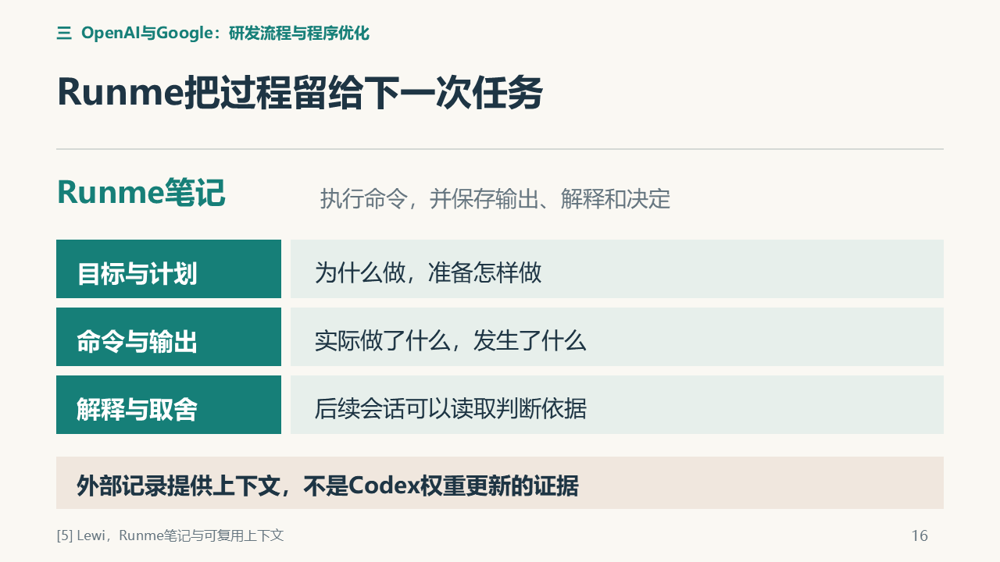
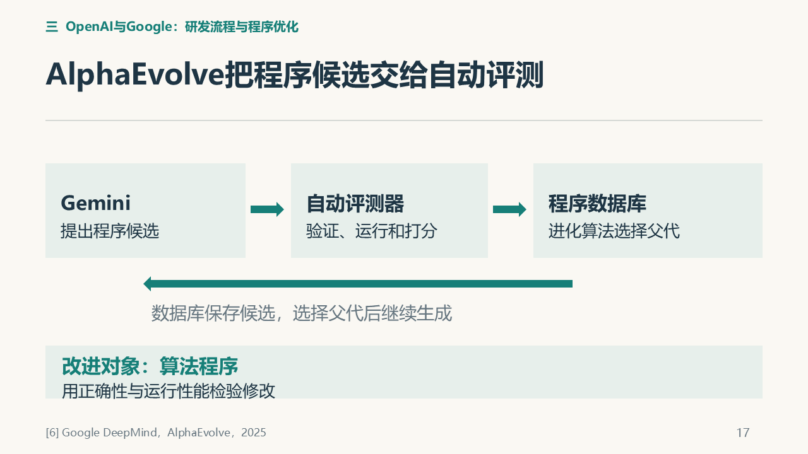

# C｜赵金城：个人报告素材

**方向：Agent改进评测流程与研发程序。** 全场14—18页；PDF第1页对应全场14页。

这份素材页已合并论述、关键图、出处和参考提示词；第二份材料是[配套投影PDF](../v5/outputs/C部分投影_V5_11.pdf)。按这两份准备即可。组长已询问老师，具体要求待助教安排：目前用于理解和准备，正式要求出来后再定稿。

[直接复制AI提示词](#交给ai的参考提示词) · [查看参考来源](#参考来源)

## 建议的文章组织

研究问题与背景 → 负责案例和机制 → 结果与分析 → 与全场主题的联系 → 真实贡献与体会 → 参考文献。结构和篇幅以助教正式要求为准，写作风格由本人选择。

## 评测任务与人的位置

Jeremy Lewi公开的Runme工作流展示了另一种应用：研究员给出评测目标，Codex读取工具说明和既有记录，拟定计划，待作者审阅批准后再执行。[5] 人参与的位置被明确保留下来。计划审阅可以检查准备跑的评测是否回答了正确问题；命令跑通本身不能保证任务选择正确。

执行结束后，Runme保留目标、计划、命令、输出、解释与决定。后续会话不仅知道结果，还能检查如何得到结果、当时为何选择下一步。这使外部记忆具有可复用内容，减少接续任务时丢失依据的可能。不过，记录存在不等于下一次一定正确使用记录，更不能说明Codex的模型参数因此更新。[5]

此材料是一位作者的实际工作流，不能替整个公司所有研发任务作保证，也未给出该流程的净提效倍数。人审阅计划是一种治理安排，不能仅凭有审批就否定一切技术自改进；判断仍应回到改变的对象与后续效果。[5]

作者要求：“Wait for me to review and approve the plan before beginning.” 即先审阅、批准计划，再由Codex执行具体命令。人还负责目标和关键取舍，不是只按一次按钮；这一流程是作者公开的个人工作流，不能代表整个公司。[5]

## 程序怎样通过运行结果改进

Google DeepMind的AlphaEvolve由Gemini生成候选程序，通过执行和评测筛选，再利用较好候选继续搜索。程序数据库保存候选，由进化算法选择父代用于下一轮生成。其公开实例把程序改进连接到了Gemini训练：所举矩阵乘法kernel加速23%，对应总训练时间减少1%。局部算子与整段训练的分母不同，不能说整体训练加速23%，也不能将时间收益改写为未报告的费用或能耗收益。原文23%描述kernel的speedup，不是该kernel耗时减少23%。官方还报告同类kernel优化由专家数周工作转为数天自动实验；这是该案例的开发收益，不能泛化为全部研发的通用比例。[6]

## 可展开的分析

两例改变的是研发流程、可复用上下文和算法程序。本例没有展示Codex或AlphaEvolve所用Gemini的参数更新；固定权重也不等于整个Agent系统不能通过更好的上下文或代码改善执行。自动评测仍依赖合适的正确性与性能指标，流程可记录并不保证目标选择正确。[5][6]

分析可围绕自动评测何时可靠、局部收益在全流程中的占比，以及记录和程序变更如何被下一次任务使用展开。这是在已有案例上形成自己的判断，不补写普遍提效结论。[5][6]

由此可以自然接到Agent自身研发：程序能被修改、运行并检验后，再问Agent的策略或工具代码是否也能成为改进对象。报告不需要为完成这一联系新增实验。

## 已有关键图

以下为最终PPT中的图示线索，配套PDF保留完整页面。图来自已有汇报材料，教学示意不是本组实验结果；书面稿按需要选图并保留图注与来源。

### 全场第16页：Runme保存目标、命令、输出与取舍



### 全场第17页：AlphaEvolve的程序候选、自动评测和父代选择



## 交给AI的参考提示词

复制本段，附本页、配套投影PDF和助教正式要求；补充自己的表达与排版偏好。

```text
请把本页和配套投影PDF作为已有内容输入，结合我提供的教师/助教正式要求，整理成我的个人课程报告。本页已包含论述素材、图示、出处、写作方向和参考提示词，报告准备以这两份材料为入口。

正式要求未提供时，只整理提纲和内容对应，不假定模板、页数、格式或截止日期。正式要求提供后，按要求和我喜欢的表达、排版风格成文；Markdown、Word或PDF按实际需要选择。把口播改为连贯书面论述，让文章能够独立阅读，图表配说明和出处。图示来自最终PPT，可据其重绘或选取相关机制，不将整页投影简单堆成报告。

复用本页已有研究，不新增实验或案例，不修改全组PPT。数字保留对象、分母和条件，公开研究结果、教学示意、本组分析、未执行建议分别表述。本组没有复现文中公开研究，不能写成自己的实验成绩。先核对我实际做过什么，再写个人贡献与体会；未知处留待本人确认，不编造学习经历或排练反馈。完成后留给我通读、修改和确认。

以本页汇总的14—18页研究素材和配套投影PDF为主体，整理OpenAI作者评测工作流与Google AlphaEvolve。讲清研究员的目标、审批和关键取舍，Codex执行获批步骤，Runme保存可复用记录；记录需要被找到和读取，不保证接续成功，也不是Codex权重更新的证据。

解释Gemini提出程序候选、自动评测和程序数据库支持进化选择。结果分析分清kernel加速23%与Gemini总训练时间减少1%；数周专家工作转为数天自动实验限定为官方同类优化案例，不能泛化为整个行业净提效。简要讨论流程与程序改进如何服务AI研发。个人贡献与体会由我按实际补充，无需增加实验。
```

## 本人最后确认

- 实际完成的工作与修改：由本人填写。
- 自己理解最深或曾经困惑的内容：由本人填写。
- 本人的判断、局限与体会：由本人填写。
- 核对图、引用和数字，按助教要求修改后再提交。

以上内容依据真实经历补充，素材准备完成不代表本人已试讲或开展实验。

## 参考来源

沿用全场固定编号；均为公开研究，未由本组复现。下列原文链接用于具体查证，不要求另读仓库旧讲稿。

**[5]** LEWI J. Automating repetitive work at OpenAI with Codex[EB/OL]. OpenAI Developers Blog,2026-08-25. [作者工作流](https://developers.openai.com/blog/automating-repetitive-work-at-openai-with-codex).

**[6]** ALPHAEVOLVE TEAM. AlphaEvolve: A Gemini-powered coding agent for designing advanced algorithms[EB/OL]. Google DeepMind,2025-05-14. [官方介绍](https://deepmind.google/blog/alphaevolve-a-gemini-powered-coding-agent-for-designing-advanced-algorithms/).
