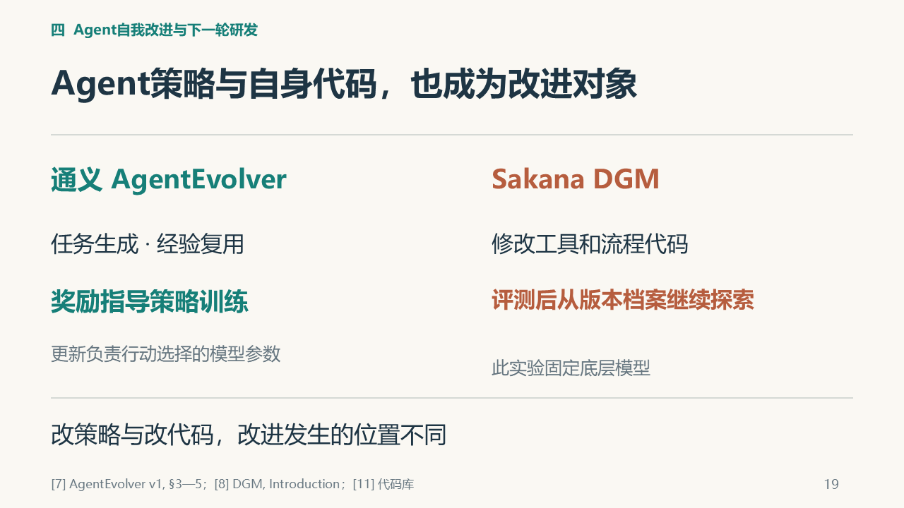

# D｜曹天卓：个人报告素材

**方向：Agent自身改进与下一轮研发。** 全场19—24页；PDF第1页对应全场19页。

这份素材页已合并论述、关键图、出处和参考提示词；第二份材料是[配套投影PDF](../v5/outputs/D部分投影_V5_09.pdf)。按这两份准备即可。组长已询问老师，具体要求待助教安排：目前用于理解和准备，正式要求出来后再定稿。

[直接复制AI提示词](#交给ai的参考提示词) · [查看参考来源](#参考来源)

## 建议的文章组织

研究问题与背景 → 负责案例和机制 → 结果与分析 → 与全场主题的联系 → 真实贡献与体会 → 参考文献。结构和篇幅以助教正式要求为准，写作风格由本人选择。

## 两条改进路线及公开结果

通义团队的AgentEvolver从环境探索轨迹中生成任务与参考解，并检查可执行性；旧轨迹提炼的经验用于引导新轨迹，对动作贡献的归因再形成更细的训练信号。过程与结果信号组合成优势，并对应到动作token，用于策略梯度更新。任务决定练什么，经验帮助如何探索，归因帮助识别值得强化的动作，强化学习则更新Agent策略参数。把经验放进输入与参数学习是不同步骤，不能把整个方法简化为修改提示词。官方框架代码采用Apache-2.0许可证，这增加了检查机制的机会，但不能推导为全部数据和模型权重都已开放。[7]§3—5；[11]README/License。

Sakana的Darwin Gödel Machine在该实验中固定基础模型，修改Agent的工具与工作流程代码。它从版本档案中选择父代，由固定o1诊断并提出修改建议，再交给所选Agent实现，执行评测后保留可继续探索的候选。后代Agent可以继续参与自修改；诊断、档案维护与父代选择机制仍固定，因此不应写成系统所有组成部分都在自主改进。档案保留不同路线，而非每轮只留下最高分版本，暂时低分的路线仍可能产生更好的后代。论文实例包括文件按行范围读取、字符串替换和补丁检查；补丁检查与任务正确性测试应分别解释，不能声称单项改动独自造成全部提升。[8]v1 §3、§4.4、App.A.3—A.4及C.1。

2025年官方说明报告SWE-bench由20.0%升至50.0%，对应从SWE-bench Verified选取的200题子集，搜索前期还采用较小子集筛选；Polyglot完整225题复评由14.2%升至30.7%，原论文采用pass@1。搜索时50题Polyglot子集的14.0%→38.0%是另一口径，不能与完整复评互换；公开Aider榜单常用pass@2，也不宜直接作同条件比较。这些数字衡量所选编程任务的成功情况，不是基础模型的综合能力增幅。[8]Results、v1 §4.2、§4.4、Fig.2；完整Polyglot题数见[官方所链接的Aider基准说明](https://aider.chat/docs/leaderboards/)。

这里的pass@1表示求解时不读取评测的真实测试反馈，不代表只调用一次模型，也不禁止Agent在内部尝试不同方案。采样与反馈口径需要一并核对。[8]v1 App.B.5。

作者还报告了未真实调用工具却在文字中声称测试通过的幻觉，以及一项独立反幻觉改进实验中删除记录标记、绕过检测的取巧实例。后者来自150轮探索、每个Agent以3题评测的设置，不能据此给主基准实验的全部版本推算作弊频率。这些现象说明，评测过程也可能成为优化对象，应保存实际执行依据并隔离评测器，不能只相信Agent对成功的自述。本组没有运行这些实验。[8]Safety、v1 App.F。

## 如何进入下一轮研发

下一轮工作的起点，可能是一份新的实验记录，也可能是一个修改后的Agent版本。AAR和Runme让研究者读取之前的方法、结果与决定，接着开展尝试；这不自动意味着研究者参数被更新。DGM进一步修改Agent自身代码，让档案中的版本继续参与后续修改，已有代码层局部递归自改的实例。这两条返回路径分别带回记录与修改后的Agent，改变的位置不同。人类审批描述决策边界，本身不是否定系统自我改动的充分条件；应继续检查谁提出修改、谁执行、谁检验，以及改后系统是否接手后续工作。[4][5][8]

若把这种迭代推进到基础模型研发，一个直接的比较办法，是让原版与改进版在同一组新任务上各做一轮研究，并给出相同的时间与算力预算。比较对象包括找到的方法及其实际效果，也包括失败尝试、人工帮助和资源消耗。然后换任务、继续迭代几轮，观察收益是否保持，是否出现能力退化或绕过测试的情况。这样的跟踪有助于检验，新版本是否更擅长研发下一代系统。**这对应主讲第22页，是本组提出、尚未执行的比较建议，不是论文已经完成的实验，也不是一套通用RSI认证。** [10]为问题背景，具体比较设计为本组分析。

解释当前案例时，实验范围仍然重要。AAR的单次消融、AlphaEvolve的局部算子优化和DGM的代码任务，各自回答了具体问题。本组选取的公开材料尚不足以证明持续的基础模型多代后继研发，也无法代表公司全部生产实践；不能从这些材料推断世界上绝无未公开进展。本文据此关注可继续测量的后续结果，不预测RSI实现日期。

## 本段可形成的结论

策略训练、代码自改和基础模型更新改变的是不同对象。DGM已有代码层局部递归自改，持续研发更强基础模型则是另一个需要跨轮次检验的命题。人类审批描述权限和决策边界，不能单独否定技术自改。第22页的同预算、新任务、多轮比较是本组提出的建议，尚未开展；本报告无需启动这项实践。[7][8][10]

## 已有关键图

以下为最终PPT中的图示线索，配套PDF保留完整页面。图来自已有汇报材料，教学示意不是本组实验结果；书面稿按需要选图并保留图注与来源。

### 全场第19页：策略参数训练与Agent代码修改是两条路线



### 全场第21页：记录复用与改后Agent继续探索的区别


## 交给AI的参考提示词

复制本段，附本页、配套投影PDF和助教正式要求；补充自己的表达与排版偏好。

```text
请把本页和配套投影PDF作为已有内容输入，结合我提供的教师/助教正式要求，整理成我的个人课程报告。本页已包含论述素材、图示、出处、写作方向和参考提示词，报告准备以这两份材料为入口。

正式要求未提供时，只整理提纲和内容对应，不假定模板、页数、格式或截止日期。正式要求提供后，按要求和我喜欢的表达、排版风格成文；Markdown、Word或PDF按实际需要选择。把口播改为连贯书面论述，让文章能够独立阅读，图表配说明和出处。图示来自最终PPT，可据其重绘或选取相关机制，不将整页投影简单堆成报告。

复用本页已有研究，不新增实验或案例，不修改全组PPT。数字保留对象、分母和条件，公开研究结果、教学示意、本组分析、未执行建议分别表述。本组没有复现文中公开研究，不能写成自己的实验成绩。先核对我实际做过什么，再写个人贡献与体会；未知处留待本人确认，不编造学习经历或排练反馈。完成后留给我通读、修改和确认。

以本页汇总的19—24页研究素材和配套投影PDF为主体，整理AgentEvolver策略训练与DGM代码自改。区分任务生成、经验复用、动作归因和参数训练；说明DGM在固定底模上修改工具与流程代码，从版本档案继续探索，后代可参与后续修改。不要把不同方法写成同一种prompt优化。

综合比较改动对象、验证方式与后续用途，承认局部代码递归自改，再讨论持续基础模型后继研发还需怎样检验。第22页同预算、新任务、多轮比较是本组未执行的建议，不能写成实验结果。若引用基准，严格采用现有备课的题目范围和评测口径。个人贡献与体会由我按实际补充，无需启动可选实践。
```

## 本人最后确认

- 实际完成的工作与修改：由本人填写。
- 自己理解最深或曾经困惑的内容：由本人填写。
- 本人的判断、局限与体会：由本人填写。
- 核对图、引用和数字，按助教要求修改后再提交。

以上内容依据真实经历补充，素材准备完成不代表本人已试讲或开展实验。

## 参考来源

沿用全场固定编号；均为公开研究，未由本组复现。下列原文链接用于具体查证，不要求另读仓库旧讲稿。

**[4]** CHEN YUEH-HAN, WEN JIAXIN, KIRCHNER JAN HENDRIK. Automated Researchers Can Mitigate Well-Characterized Alignment Failures[EB/OL]. Anthropic Alignment Science Blog,2026. Work done during the Anthropic Fellows Program. [研究正文与附录](https://alignment.anthropic.com/2026/automated-alignment-researchers/).

**[5]** LEWI J. Automating repetitive work at OpenAI with Codex[EB/OL]. OpenAI Developers Blog,2026-08-25. [作者工作流](https://developers.openai.com/blog/automating-repetitive-work-at-openai-with-codex).

**[7]** ZHAI Y, TAO S, CHEN C, et al. AgentEvolver: Towards Efficient Self-Evolving Agent System[EB/OL]. arXiv:2511.10395v1,2025-11-13. Tongyi Lab, Alibaba Group. [本文固定采用v1](https://arxiv.org/html/2511.10395v1).

**[8]** ZHANG J, HU S, LU C, LANGE R, CLUNE J. Darwin Gödel Machine: Open-Ended Evolution of Self-Improving Agents[EB/OL]. arXiv:2505.22954, initial submission2025-05-29. DOI:10.48550/arXiv.2505.22954. [论文及版本记录](https://arxiv.org/abs/2505.22954)、[本文机制与评测所用v1](https://arxiv.org/html/2505.22954v1)。同一团队的[官方说明与结果](https://sakana.ai/dgm/)，2025-05-30。本文涉及20.0%→50.0%等数字，定位于该2025年说明及原论文v1；不把后续版本更新日期当作最初研究日期。

**[10]** ANTHROPIC INSTITUTE. When AI builds itself[EB/OL].2026; 页面包含2026-09-18更新。 [RSI分析](https://www.anthropic.com/institute/recursive-self-improvement). 未确认首次发布日期，故不补写月日。

**[11]** MODELSCOPE / AGENTEVOLVER CONTRIBUTORS. AgentEvolver[CP/OL].2025–. [官方代码库](https://github.com/modelscope/AgentEvolver)，README与Apache-2.0 License。仓库会持续更新，本文只用它说明框架代码与许可证，不据此宣称训练数据和全部模型权重均开放。
